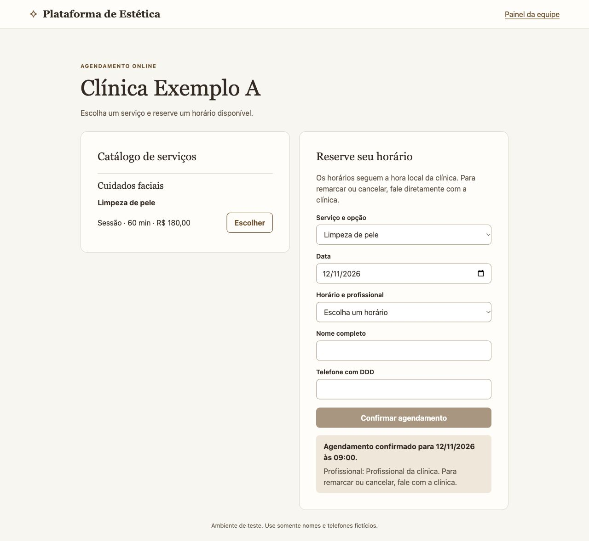
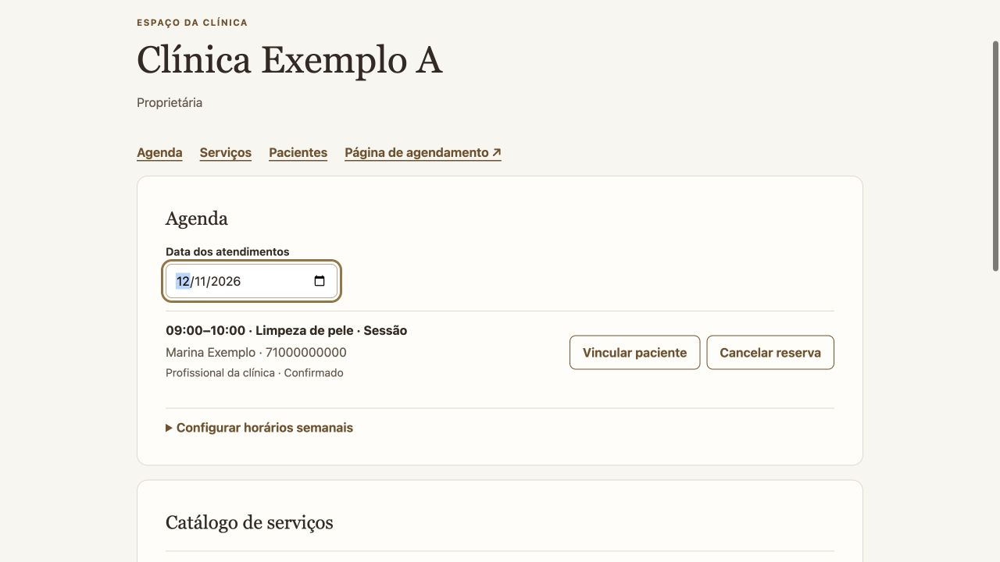
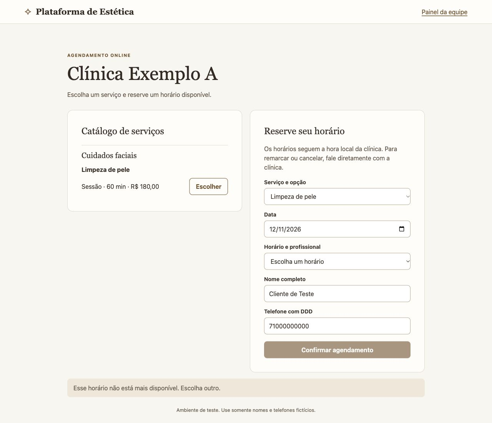
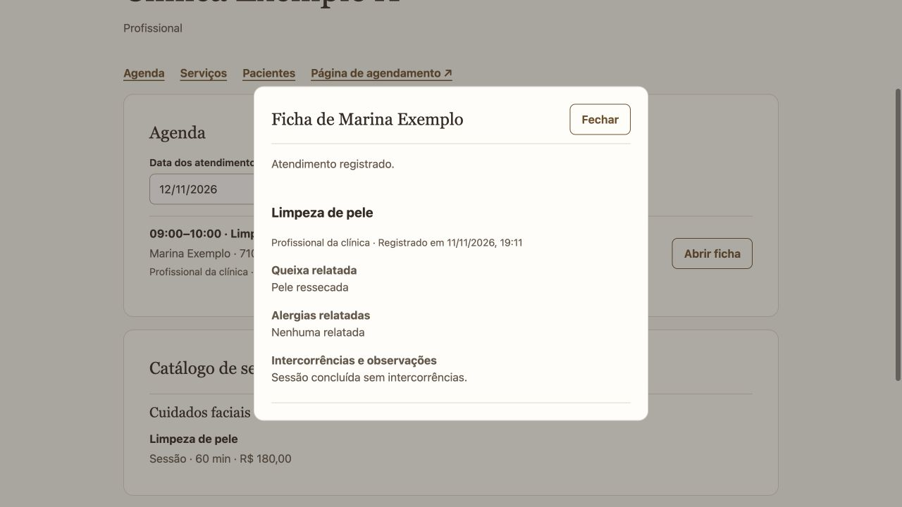

# Demo em quatro telas

Plataforma de agendamento para clínicas · Luís Felipe Andrade

Capturas da aplicação rodando com uma clínica e pacientes fictícios.

## Reserva confirmada

Marina escolhe Limpeza de pele às 9h. A página confirma a reserva.

## Reserva na agenda da clínica

A equipe abre a data e vê uma única reserva confirmada das 9h às 10h.

## Segunda tentativa bloqueada

Outra pessoa já tinha selecionado as 9h em uma segunda aba. O servidor recusa a confirmação porque o horário foi ocupado.

## Atendimento na ficha

A equipe vincula a reserva ao cadastro fictício. A profissional designada registra o procedimento e a ficha exibe o histórico.

